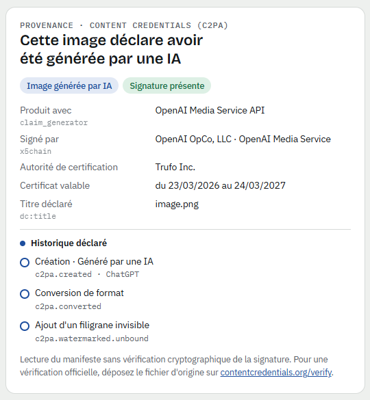

# Révélateur photo

**See what your photos reveal about you, strip the personal data before you post them, and read where an image really comes from.**

Révélateur photo ("photo developer" in French) is a single-page, open source web tool that runs entirely in your browser. Drop a JPEG, PNG or WebP and it shows you two things side by side:

- **Privacy**: the personal metadata hidden in the file (exact GPS position, camera make, model and serial number, author name, capture date, editing software), with a one-click clean copy.
- **Provenance**: the file's [Content Credentials (C2PA)](https://c2pa.org): which tool produced the image, who signed it and when, and whether it declares being AI-generated.

No upload, no server, no tracking. Your photo never leaves your device.

<p align="center">
  
</p>

## Why

Every photo you share can carry far more than pixels. A picture taken on a phone or a camera often embeds the exact coordinates where it was shot, the device's serial number and the owner's name. Most people never see this data, and many websites and messaging apps pass it along untouched.

At the same time, AI-generated images increasingly carry signed provenance data. Being able to read it helps anyone check what they are looking at.

Révélateur photo puts both views in one place, in plain language.

## Features

**Privacy**
- Detects EXIF, XMP, IPTC, PNG text chunks, JPEG comments, embedded thumbnails and data appended after the image
- Shows GPS coordinates with a link to the location on OpenStreetMap
- Flags device identifiers: body and lens serial numbers, owner name, unique image ID, MakerNote
- Removes all of it **without re-encoding the image**: no quality loss, colour profile and orientation preserved
- Re-inspects the cleaned file to confirm nothing personal is left

**Provenance (C2PA)**
- Parses the JUMBF / CBOR manifest store in JPEG (APP11), PNG (`caBX`) and WebP (`C2PA`)
- Shows the claim generator, the signing certificate (subject and issuer), the timestamp and the declared action history
- Recognises IPTC `DigitalSourceType` values such as `trainedAlgorithmicMedia` (AI-generated)

<p align="center">
  
</p>

## Design choice: provenance is never removed

This tool protects **your** privacy. It does not hide where an image comes from.

When cleaning a file, Révélateur photo always keeps:
- the C2PA Content Credentials,
- the IPTC digital source type when it marks AI-generated content,
- the colour profile.

It does not touch invisible watermarks either. With the EU AI Act and the rise of deepfakes, transparency about generated content matters. If you are looking for a way to make AI images pass as real photos, this is not that project, and pull requests in that direction will not be accepted.

## How to use

1. **Open the tool.** Open `index.html` in any modern browser (Chrome, Edge, Firefox, Safari), or use the hosted version on GitHub Pages: https://brik-avo.github.io/revelateur-photo/
2. **Load a photo.** Drag and drop it onto the drop zone, click *Choisir un fichier* (Choose a file), or paste it with Ctrl+V. A fictitious sample loads by default so you can see what a report looks like.
3. **Read the privacy panel** (*Vie privée*, left). Each finding is grouped and colour-coded:
   - 🔴 **Location**: exact GPS coordinates, with a link to the spot on the map
   - 🟠 **Device and author**: camera serial number, owner, author name, copyright
   - ⚪ **Date, software and shooting settings**: lower risk, but they still date and profile the photo
4. **Read the provenance panel** (*Provenance*, right). If the image carries Content Credentials, you see which tool produced it, who signed it, when, and the declared edit history, including whether it was generated by AI.
5. **Download the clean copy.** Click *Télécharger la version nettoyée* (Download the cleaned version). You get `yourphoto_sans-donnees-perso.jpg` (or `.png` / `.webp`). The tool re-inspects the result and confirms that no personal data is left.
6. **Post it** wherever you want: social networks, a marketplace listing, a CV, a website.

Typical use cases: selling an item online without revealing your home address, sharing holiday photos without your camera's serial number, sending a CV photo, checking whether a viral image declares being AI-generated.

## Getting started

There is nothing to install. The whole app is one HTML file with no dependencies.

```bash
git clone https://github.com/Brik-Avo/revelateur-photo.git
cd revelateur-photo
open index.html        # macOS  (xdg-open on Linux, start on Windows)
```

It also works when hosted as a static page: GitHub Pages, Netlify, any web server, or a WordPress page via an HTML block or iframe.

A sample photo with a fictitious GPS position and author is included in [`samples/`](samples/) and loads by default.

## Run the test

```bash
npm install
npm test
```

The smoke test opens the page in headless Chromium, cleans the sample photo and checks that no EXIF remains while the image still decodes.

## Supported formats

| Format | Read metadata | Clean | Read C2PA |
|---|---|---|---|
| JPEG | ✅ | ✅ | ✅ |
| PNG  | ✅ | ✅ | ✅ |
| WebP | ✅ | ✅ | ✅ |
| HEIC | ⏳ planned | ⏳ planned | ⏳ planned |

## Limitations

- The C2PA signature is **read, not cryptographically verified**. For an official check, use [contentcredentials.org/verify](https://contentcredentials.org/verify).
- Once a file carrying Content Credentials is cleaned, a C2PA validator will report that the file changed after signing. That is expected and honest.
- The absence of Content Credentials proves nothing: most platforms strip them on upload.
- The interface is in French for now. English translation is welcome as a contribution.

## How it works

Everything is plain JavaScript in [`index.html`](index.html):

1. The file is read as bytes with the File API.
2. Each format is split into its native blocks (JPEG segments, PNG chunks, RIFF chunks).
3. EXIF is parsed from its TIFF structure, XMP from its packet, C2PA from its JUMBF boxes and CBOR payloads, and the signer from the X.509 certificate in the COSE signature.
4. Cleaning keeps the image data and the provenance blocks, drops everything else, and rebuilds a valid file (PNG CRCs and WebP RIFF sizes included).

No library, no build step, no network request beyond the web fonts.

## Contributing

Issues and pull requests are welcome, especially for:
- HEIC / AVIF support
- an English (and other languages) interface
- C2PA signature verification

## License

[MIT](LICENSE) © Kevin Aquino, [SOSPC82](https://sospc82.fr)
